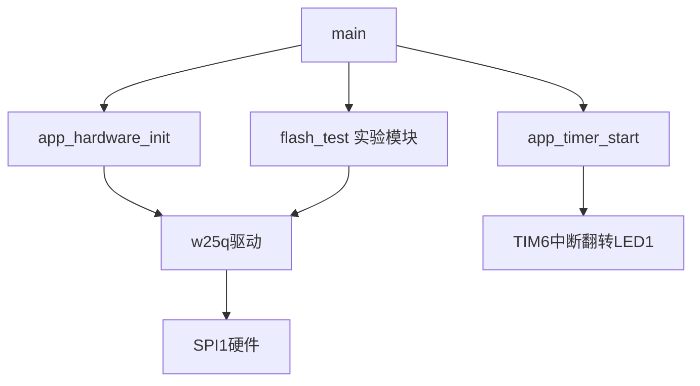

# 实验二：W25Q Flash 读写与 OTA 分块存储基础

本实验基于 STM32F407VET6，验证外置 W25Q 的识别、读取、状态查询、擦除、页编程和跨页写入，最后模拟分块接收固件并追加保存。它是天气时钟 OTA 的存储基础，不是完整 OTA。

文档更新：2026-11-12。以当前源码及用户实测记录为依据。

## 工程与环境

- Keil 工程：[mdk/stm32f407.uvprojx](mdk/stm32f407.uvprojx)
- 工具：Keil µVision、ARM Compiler 5.06 update 7、ST-Link。
- 外设使用 STM32 标准外设库，内核接口使用 CMSIS。
- App 链接起点：`0x08010000`，容量：`0x30000`（192KiB），向量表偏移：`0x10000`。
- 本工程依赖实验一的 Bootloader 从内部 Flash 起点接力启动。此分区是 LED 教学布局，不能直接作为正式天气时钟布局。

## 硬件连接

| 功能 | STM32引脚 |
| --- | --- |
| SPI1 SCK | PA5 |
| SPI1 MISO | PA6 |
| SPI1 MOSI | PA7 |
| 第一颗W25Q CS | PE13，低有效 |
| 第二颗W25Q CS | PE14，低有效 |
| LED1 | PB0，低电平亮 |

SPI为主机、8位、模式0、MSB先传、软件片选、128分频。PCLK2为84MHz时，SCK约656.25kHz。两颗片选下实测JEDEC ID均为`0xEF4018`，符合W25Q128（16MiB）。第二颗擦写和独立片选隔离尚未验证。

## 模块与调用关系

```text
app/main.c                   入口及实验执行顺序
app/app_init.c/.h            板级、LED、SPI初始化
app/app_timer.c/.h           TIM6配置和唯一的TIM6_DAC_IRQHandler
app/flash_test.c/.h          实验步骤、手动请求及Watch结果
app/board.c/.h               已有板级资源
 driver/w25q.c/.h            Flash驱动及SPI收发
 driver/led.c/.h             LED驱动
```



启动时依次识别两颗芯片、读取地址1的16字节、读取SR1、完成第一颗WEL开关验证、读取第一颗最后一个扇区，然后启动TIM6。主循环轮询手动实验请求，默认不执行擦除或编程。

后续实验按职责扩展实验模块，驱动不依赖Watch变量。TIM6及共享中断入口由app_timer统一管理，不重复定义。

## Flash命令与接口

| 命令 | 用途 | 接口 |
| --- | --- | --- |
| 9F | JEDEC ID | w25q_read_jedec_id |
| 03 | 读取存储内容 | w25q_read_data |
| 05 | 读取状态寄存器1 | w25q_read_status1 |
| 06 / 04 | 开启 / 关闭写使能 | w25q_write_enable / w25q_write_disable |
| 20 | 擦除4KiB扇区 | w25q_erase_sector |
| 02 | 单页编程 | w25q_page_program |
| — | 按256字节页边界拆分编程 | w25q_write_data |
| — | 有限次数查询BUSY | w25q_wait_ready |

SR1的bit0为BUSY，bit1为WEL。SPI的BSY与Flash内部BUSY不同。单页编程不能跨页，跨页接口不自动擦除。页编程只能将位由1改为0，擦除恢复为FF。

`max_polls`是最多查询次数，不是毫秒。写入/擦除返回true仍需读回验证；返回false可能已部分修改或芯片仍忙，不能盲目重试。

## 测试区与数据保护

修改操作固定使用第一颗Flash最后一个扇区：`0xFFF000～0xFFFFFF`，共4096字节。地址0附近原数据不修改。

原始扇区为全FF，已导出并核对完整4096字节。备份位于项目工作区`work/项目升级/Flash备份/第一颗_0xFFF000_2026-11-11`，包括HEX、BIN和说明。HEX记录的是当时RAM快照地址，不可直接当作外部Flash地址使用。

截至最新实测，测试扇区前1000字节保存模拟分块下载数据，后3096字节为FF。重新上电不会自动恢复为空白。此测试区不代表正式OTA下载区已规划完成。

## 编译、下载和调试

1. 打开本目录下的Keil工程，核对app分组包含新增模块。
2. 若文件被外部修改，重新加载磁盘版本，避免旧编辑缓冲区覆盖。
3. 保存、Rebuild，确认无错误。
4. 退出调试，Flash Download选择Erase Sectors，开启Program、Verify，保留Bootloader，不选Erase Full Chip。
5. Download后进入调试、Run，待启动实验完成，再暂停观察Watch。
6. 若需手动实验，只修改对应request为1，Run后再暂停。每次只触发一个实验。

当前进入调试不会自动下载，请勿把编译完成当作板上程序已更新。所有手动实验每次上电最多尝试一次，失败也锁定，复位后才重新允许尝试。只修改request，不手改result。复位不清除外置Flash内容。

## Watch与预期结果

### 启动阶段

| 变量 | 含义 / 参考结果 |
| --- | --- |
| g_w25q1_id、g_w25q2_id | EF4018 |
| g_w25q1_status、g_w25q2_status | ID通信结果，1为完成 |
| g_w25q1_read_status、g_w25q2_read_status | 地址1小范围读取结果，1为完成 |
| g_w25q1_data、g_w25q2_data | 两颗地址1开始的16字节，不是末尾测试区 |
| g_w25q1_sr1_result、g_w25q2_sr1_result | SR1通信结果，1为完成 |
| g_wel_before、g_wel_after_enable、g_wel_after_disable | 实测00→02→00 |
| g_wel_test_result、g_wel_disable_result | 实测均1 |
| g_sector_read_result | 启动时完整扇区读取结果，1为成功 |
| g_sector_non_ff | 启动时扇区非FF字节数 |
| g_sector_snapshot[4096] | 完整扇区RAM快照，部分后续实验会覆盖它 |

### 手动实验

| 实验 | 触发变量写1 | 成功判断 |
| --- | --- | --- |
| 扇区擦除 | g_sector_erase_request | erase_result=1、sector_after_non_ff=0 |
| 单页写16字节00～0F | g_page_program_request | page_program_result=1、page_mismatch=0 |
| 跨页写300字节 | g_cross_request | cross_result=1、cross_invalid_pass=5、cross_mismatch=0 |
| 模拟三块追加1000字节 | g_download_request | download_result=1、blocks=3、bytes=1000、mismatch=0、tail_non_ff=0 |

表内省略前缀的结果名均带`g_`，准确名称及各失败码见flash_test.c注释。0通常表示未执行，不表示通过；request变0只表示请求被消费。统计必须结合对应result判断，启动快照不会自动随Flash变化更新。

单页写入起点FFF000，跨页起点FFF0FA、长度300，拆为6+256+38。它们先检查目标全FF，不自动擦除，目标已有数据时会拒绝。不要同时设置多个请求，失败保留现场。

## 综合实验：模拟分块下载

建议复现时使用新一次启动，保持其他三个手动请求为0，仅设置`g_download_request=1`。

注意：本实验会主动擦除第一颗最后一个扇区，覆盖此前所有测试数据。

```text
擦除一次并确认全FF
 → 追加137字节到FFF000
 → 追加509字节到FFF089
 → 追加354字节到FFF286
 → 读回整个扇区
 → 比较前1000字节，并检查尾部3096字节未改变
```

源数据为`(uint8_t)i`，包含00、FF、CR、LF。每块按长度处理，不使用字符串长度。跨页拆分由驱动完成，不能每收到一块就重擦整个扇区。

实测：result=1、blocks=3、bytes=0x3E8（1000）、mismatch=0、tail_non_ff=0。本轮1000字节数据尚未单独完成断电重读验收。若进行该验证，不触发任何修改请求，重新上电后的sector_non_ff预期997（0x3E5），因为1000字节中有3个FF。

这只是模拟网络接收：没有实际ESP32通信、HTTP、CRC或READY状态。未来数据流为服务器→ESP32→串口→STM32 RAM→W25Q。

## 已验证与未验证

已验证：两颗识别及小范围读取、SR1读取、第一颗WEL控制、指定扇区读取备份、单页写入读回、该16字节重新上电保留、写后擦除、跨页写入及五种非法参数拒绝、三块模拟追加及尾部保护。

未验证：第二颗擦写、全容量、独立片选隔离、跨页及1000字节数据独立断电重读、擦写过程中断电恢复。未实现实际网络下载、固件CRC包、内部Flash安装、持久升级状态及完整天气时钟OTA。

最近综合实验构建日志：`work/项目升级/w25q_download_sim_build.log`，0错误、4条原有board.h警告（两个问题被两个文件分别引用）。当次Code6284、RO436、RW176、ZI7080，以重新构建结果为准。

## 下一阶段与详细资料

下一步核对Bootloader及LED App实际链接布局和固件大小，用独立工程验证W25Q暂存固件→Bootloader安装到内部Flash→启动新版LED，再接入网络和天气时钟。

- [实验二操作手册](../../outputs/实验手册/实验二_W25Q识别_操作手册.md)
- [代码阅读与调用关系](../../outputs/实验手册/实验二_代码阅读与调用关系.md)
- [OTA每日学习笔记](../../outputs/OTA每日学习笔记.md)
- [OTA总路线](../../outputs/天气时钟OTA学习与实验路线.md)
- [开发板连接信息](../../outputs/参考资料/开发板原理图关键信息.md)
- [W25Q128JV数据手册](../参考资料/W25Q128JV_RevG_数据手册.pdf)
